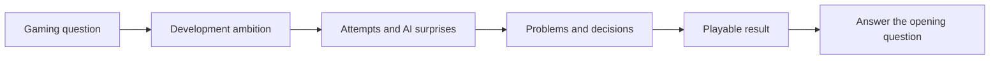

# Maindeveloper — Studio Channel Approach

> [!abstract] The approach
> **A gaming question attracts the viewer. The development struggle carries the story. The resulting gameplay delivers the payoff.**
>
> Make entertaining developer videos about the experiences players care about: mastering combat, attempting challenges, discovering powerful interactions, and entering memorable worlds. Use the real process of creating those experiences in Last Rite as the story, with AI's mistakes and surprises supplying recurring comedy.

## 1. Channel brief

| Element | Direction |
|---|---|
| **Channel** | Maindeveloper, the main studio channel. |
| **Primary audience** | Gamers who have played **Clair Obscur: Expedition 33 and Elden Ring**, especially those interested in mastery, combat decisions, distinctive bosses and atmospheric worlds. |
| **First game** | **Mani Kalpa: One Last Rite**, shortened to Last Rite. |
| **Long-term purpose** | Build an audience for the studio across substantial games, with multiple videos supporting each game. |
| **Presentation** | Approachable narrator, visible competence, comic frustration, concrete demonstrations and recurring jokes. |
| **AI's role** | An openly acknowledged, unpredictable collaborator across concepts, art, design, code architecture and implementation. |
| **Production constraint** | **Six main videos, with a few clips.** |
| **Growth ambition** | **10,000 subscribers by October 31, 2026.** A stretch target, not an established forecast. |
| **Starting position** | A brand-new channel without an established name or audience. Every episode must work for a first-time viewer. |

**Scope:** this note records the agreed approach for the **studio/developer channel**. The existing [[Content Formula - Game Breakdown]] covers BGamer's game-breakdown and recommendation format. The two formats have different jobs; this note governs Maindeveloper's videos about making the studio's own games.

## 2. The audience determines the question

The primary viewer is a player. They do not need to know Unity, understand code architecture or want to become a developer to enjoy an episode.

Start with an interest they already have:

| Player interest | A question that can organize an episode |
|---|---|
| **Combat mastery** | Can someone learn this encounter well enough to control it? |
| **Challenges** | Is an unusual way of winning actually possible? |
| **Builds and synergies** | Can a risky or overlooked choice become a powerful strategy? |
| **Fairness and boss design** | Can an attack deceive the player while remaining readable? |
| **Weapons and expression** | Can the same weapon support meaningfully different decisions? |
| **Worlds and creatures** | What makes this enemy or place disturbing, intriguing or memorable? |

These are editorial opportunities, not a requirement to add new systems. Use the choices Last Rite actually supports. Interest in builds does not require inventing a large equipment or skill-tree system for the sake of videos.

The audience also has room for atmosphere, music and emotional meaning. Keep those present in creature stories, environments and final reveals. Last Rite's planned facility and transformed staff offer material beyond combat difficulty.

## 3. The five fixed presentation traits

These are the selected foundations from the Dani analysis. They should survive changes in episode subject or game.

| Trait | What it means on screen |
|---|---|
| **Visible competence with comic frustration** | Show a clear ambition, genuine problems and considered decisions. The narrator can struggle while still demonstrating judgment and persistence. |
| **Concrete demonstrations** | Regularly show what changed. Gameplay, an animation or a before/after comparison should make the explanation tangible. |
| **Recognizable recurring elements** | Return to familiar enemies, test characters, AI mishaps and jokes. Returning viewers get callbacks; new viewers receive enough context to follow them. |
| **An approachable narrator** | Explain the parts necessary to understand the story. Technical detail earns its place by clarifying a consequence the player can see. |
| **Exaggerated visual conflict** | Use readable subjects, silhouettes, contrast and comparisons. Thumbnails and edits should make the episode's central problem understandable at a glance. |

With AI doing substantial production work, competence is visible through **direction, selection, testing, rejection and refinement**. Be accurate about which work AI generated and which decisions the developer made.

## 4. How a gaming premise becomes a developer video

The **subject** can be a challenge, a powerful strategy or a mastery fantasy. The **story** follows the developer trying to make it work inside the game.



The episode's title and opening establish something worth finding out. The middle follows real development: attempts, mistakes, unexpected interactions and important choices. The ending demonstrates the result and answers the question.

Gameplay footage provides evidence throughout. A final attempt or a tester's reaction can deliver the payoff without requiring the whole video to become a challenge run.

> [!important] The promise must be fulfilled
> If the opening asks whether a strategy works, show a meaningful test and give a verdict. If it promises a transformation, show the resulting difference. An unsuccessful experiment can still be a complete story when the conclusion is honest and satisfying.

The words **“I made”** or **“I built”** are not forbidden. What matters is whether the premise offers an interesting experience, consequence or uncertainty. A feature name alone is usually insufficient context for an unfamiliar viewer.

## 5. AI as a recurring collaborator

AI is part of the actual production process, so its involvement should be visible and candid. Its strongest comic role is to interfere with an ambition the audience already understands.

| Area | Material worth capturing when it actually happens |
|---|---|
| **Concepts and design** | A confident suggestion that sounds impressive but fails when turned into a playable decision. |
| **Art and assets** | A creature that misses the intended personality, inconsistent proportions, or an object that becomes absurd when used in the scene. |
| **Animation** | An impressive pose that falls apart in motion, an unreadable attack or a transformation that cannot connect convincingly. |
| **Code and architecture** | A feature that creates an unexpected gameplay consequence, or a proposed structure that makes the next necessary change difficult. |
| **Balancing** | An interaction that becomes too weak, too powerful or much more interesting than expected. |

**Establish the intention before showing the mistake.** A short instruction, proposal or response is often enough context. Then show the result, the reaction and the decision it forces.

Recurring devices could include an overconfident “AI department,” a familiar test dummy or a repeated approval stamp. These are optional presentation devices, not prerequisites for production.

Keep the incidents real. Do not fabricate logs, failures, player reactions or results. Preserve unexpected successes too: AI's contribution can be useful, surprising and sometimes worth defending.

**The failure earns the laugh; the resulting game earns interest in Last Rite.** Leave room for clean gameplay and atmospheric reveals so the finished work has an identity beyond the mishaps.

Use AI in a title when its involvement creates the central question. Otherwise, the gaming premise can lead while the video openly shows AI's role.

## 6. Candidate premises for Last Rite

> [!note] Examples, not a locked slate
> These illustrate the agreed approach. They are not claims about current implementation, recorded incidents or proven outcomes. Select the final six using the actual development backlog and available footage. Write the final title after the evidence supports it.

| Provisional premise | Development story underneath it | Required payoff |
|---|---|---|
| **Can you beat this boss without pressing attack?** | Make defensive counters support an interesting approach; investigate damage, encounter rhythm and unexpected interactions. | A test under clearly stated rules, with a verdict on whether it works and feels worthwhile. |
| **Can you tell when this boss is lying?** | Develop feints through animation, timing and behaviour; deal with attempts that become obvious or unreadable. | Let viewers read the attacks, reveal the tells and show the improved encounter. |
| **Could losing your sanity become the strongest strategy?** | Explore Last Rite's planned power/sanity trade-off and the incentives it creates. | Demonstrate the benefits, costs and competing choices that actually exist in the build. |
| **Can one weapon support two completely different fighting styles?** | Make a planned transformation matter through moves, animation and decisions. | Show the difference in play, including where each approach succeeds or struggles. |
| **This monster used to save lives.** | Turn a former member of the facility's staff into a coherent creature, connecting its history, silhouette, equipment and behaviour. | Reveal a creature whose visual and gameplay details express the intended story. |

A substantial game can support several episodes around the same subject. An enemy may return through its visual design, behaviour, combat interactions and later encounters. Each return needs a fresh question and a complete payoff.

## 7. Worked episode: winning without pressing attack

**Premise:** can this particular encounter be beaten without pressing the attack button?

**Rule clarity:** automatic counter damage may be allowed; say so. Do not call it a pacifist or no-damage run unless those are genuinely the rules and the footage supports them.

| Beat | What the viewer sees | Why it belongs |
|---|---|---|
| **1. Tease the question** | An intriguing moment from the real attempt, followed by the rule. | Establishes an outcome worth waiting for. |
| **2. Set the ambition** | Explain why learning the boss should make a defensive approach viable. | Connects the experiment to the experience being designed. |
| **3. Show the first version** | Demonstrate the initial implementation and its actual limitations. | Gives the viewer a clear starting point. |
| **4. Follow the complications** | Relevant AI outputs, visible failures and unexpected interactions. | Supplies comedy and keeps the outcome uncertain. |
| **5. Show the decisions** | Compare important changes and explain the player-facing reasons for them. | Makes the developer's judgment visible. |
| **6. Deliver the test** | A sufficiently clear attempt, followed by the result and remaining limitation. | Answers the original question and demonstrates Last Rite. |

Possible complications might involve weak counters, excessive rewards or a dull encounter rhythm. These are possibilities to investigate, not incidents to script in advance. The real development determines the middle of the video.

## 8. Capture the story while doing necessary work

Use this production sequence:

**Choose necessary development → identify the gaming question → record attempts and decisions → find the actual story → package the strongest supported outcome.**

The question can be chosen before work starts. The precise story, final title and thumbnail should follow the evidence collected.

For each promising task, capture:

- The starting state and intended experience.
- The AI instruction or response needed to understand an important incident.
- Visible failures, surprising successes and immediate reactions.
- Short comparisons around meaningful decisions.
- Clean footage of the resulting gameplay, creature or environment.
- A final attempt or other evidence that answers the episode's question.

Record useful moments rather than narrating every working session. Routine implementation can be compressed. Preserve enough of the actual process to make the result feel earned.

### Reusable episode brief

```text
Player-facing question:
Why an Expedition 33 / Elden Ring player would care:
Necessary Last Rite development task:
What is already implemented and recordable:
What remains uncertain:
AI's actual role:
Starting state to capture:
Important attempts and decisions:
Final test or reveal:
Returning character / joke / visual element:
Provisional title and thumbnail idea:
Potential clip from the same footage:
Verdict after development — what really happened:
```

Before committing one of the six main-video slots, confirm that the premise works for someone unfamiliar with the channel, advances necessary game work, and can produce a visible answer or reveal.

## 9. Packaging, clips and continuity

**Titles:** lead with a gaming question, surprising consequence or compelling experience. Familiar game references can explain an influence when the comparison is genuinely demonstrated. Last Rite should become recognizable through repeated exposure to its own world and mechanics.

**Thumbnails:** make one main conflict readable. Use a boss, weapon, character or environment from the game as the visual subject where possible. Comparisons, timing cues and reaction elements should clarify the actual premise.

**Continuity:** reuse recognizable enemies, names, jokes and visual motifs across episodes. Briefly reintroduce anything essential so every upload remains accessible to a new viewer.

**Clips:** make a few complete moments from the same production footage: an AI mistake with its consequence, a readable feint, a successful counter sequence, a creature transformation or a surprising interaction. Their editing should serve the moment; the separate BGamer recommendation channel's bookend-loop rules do not automatically apply here.

**Game interest:** end with a relevant next step that is actually available, such as following the next experiment, wishlisting the game or trying a public build. Do not imply a demo or store page exists before it does.

## 10. Six videos and the growth target

The agreed constraint is **six main videos plus a few clips**, with an ambition of **10K subscribers by October 31, 2026**. The individual subjects, order and release dates remain to be chosen.

Mastery, challenges and meaningful combat choices are leading subject areas. Creature and world stories provide room for Last Rite's atmosphere and identity. No exact topic allocation is locked by this document.

Treat the first releases as evidence for improving the remaining ones. Review:

- **Discovery:** impressions and click-through rate, considered together with traffic source.
- **Story delivery:** opening retention, important drop-offs and whether viewers reach the payoff.
- **Channel growth:** subscribers gained by each video and returning viewers as enough data accumulates.
- **Interest in the game:** questions about encounters, remembered characters, requests to play and tracked store visits or wishlists when available.

Compare videos at similar ages. Public results from established channels and Shorts are references for ideas, not a forecast for a new channel's six long-form uploads.

### Remaining planning inputs

- What is currently playable and polished enough to show?
- Which genuine AI incidents and development attempts are already recorded?
- What recording and editing time is available?
- Is there a store page or playable build that an interested viewer can use?
- Which necessary development tasks can support complete stories within the remaining schedule?

## 11. References behind the approach

Research checked September 24–25, 2026. These examples informed the approach; they are not evidence that every viewer of one game watches every format listed.

| Reference | What to study |
|---|---|
| [Dani](https://www.youtube.com/@Danidev/featured) | The five selected presentation traits: competence, comic frustration, demonstrations, recurring elements and approachable narration. |
| [Vedinad — excessive speed](https://www.youtube.com/watch?v=AZQOmjHrXzw) | A Short connecting player builds, movement changes and a consequence gamers understand. |
| [Vedinad — can anyone beat the game?](https://www.youtube.com/watch?v=EIgdgGEa8BM) | Development framed through difficulty and an invitation to attempt the game. |
| [Inbound Shovel — speedrunner playtest](https://www.youtube.com/watch?v=_AvKJqzuLiY) | An ongoing game's development told through an uncertain outcome, player discoveries and a meaningful design problem. |
| [ONGBAL — Expedition 33 parry-only fight](https://www.youtube.com/watch?v=YBMu9n49_S0) | The clarity and satisfaction of a combat-mastery payoff. |
| [Arktix — Expedition 33 builds](https://www.youtube.com/watch?v=6g_w3aRNyKo) | The audience's interest in understanding choices and powerful interactions. |
| [Cilvanis — difficult parry timings](https://www.youtube.com/watch?v=yj6JbgMdrZo) | Comedy built around a frustration recognizable to players of both target games. |
| [DougDoug — AI playing an adventure game](https://www.youtube.com/watch?v=W3id8E34cRQ) | A comprehensible gaming task that makes AI's unpredictable participation entertaining. |
| [Daryl Talks Games — Expedition 33](https://www.youtube.com/watch?v=OsO3A5tsyW4) | Player interest in meaning, characters, art and emotional consequences alongside mechanics. |

## Related vault notes

- [[Content Formula - Game Breakdown]] — BGamer's separate game-recommendation format.
- [[Game Content Formats]] — the broader YouTube format inventory.
- [[1 Parry Combat - Last Rite]] — game overview and design references.
- [[1f Last Rite - Combat Iteration Log]] — changes to combat decisions over time.
- [[1h Last Rite - Player Moveset & Animation Plan]] — planned weapon and moveset details.
- [[1j Last Rite - Shroud, Mani & Sanity]] — the survival and sanity trade-off.
- [[1k Last Rite - Lore Bible]] — authoritative fiction for creature and world stories.

---

> [!quote] Editorial north star
> Watch a developer try to create the experiences you love in games, struggle with an unpredictable AI collaborator, and show what actually survives the process.
